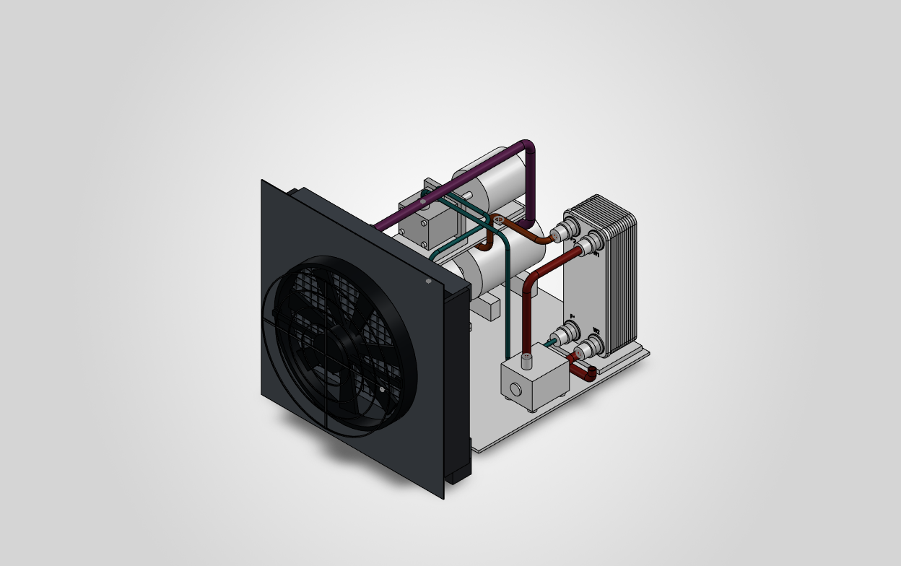
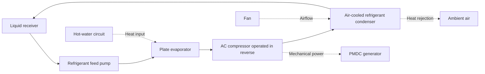

# Waste Heat Recovery System Using an Organic Rankine Cycle

**Team Noorc · Compact ORC design with direct air cooling**

A small-scale Organic Rankine Cycle (ORC) system designed to recover low-grade waste heat and convert it into electrical energy. The project combines an **AC compressor operated in reverse**, a refrigerant feed pump, a plate evaporator, a generator, and a direct air-cooled refrigerant condenser.

This repository contains the SolidWorks assembly, individual components, STEP exports, piping layouts, and engineering documentation for the current design.



> **Development status:** CAD layout and component envelopes are available. Equipment selection, mechanical interfaces, fabrication details, and integrated performance still require validation. This is a prototype design package, not a manufacturing release or a demonstrated power-generation system.

## Project overview

Waste heat from engines and small industrial processes can be difficult to recover economically at a small scale. This project explores a compact ORC built around commercially available and repurposed components to reduce the need for custom machinery.

The organic working fluid absorbs heat in an evaporator, expands through an AC compressor operated in reverse, and transfers mechanical power to a generator. An air-cooled condenser then returns the fluid to liquid form for recirculation.

The current design focuses on:

- Recovering low-grade heat through a closed refrigerant loop.
- Using an AC compressor in reverse as the expansion device.
- Keeping the assembly compact and modular.
- Removing the secondary condenser cooling-water circuit.
- Documenting component placement, pipe routing, and unresolved engineering work.

## How the system works



1. **Pressurisation:** the feed pump supplies liquid working fluid to the evaporator.
2. **Heat addition:** a separate hot-water circuit supplies heat through the plate evaporator.
3. **Expansion and generation:** the AC compressor is intended to operate in reverse, producing mechanical power for the generator.
4. **Condensation:** the refrigerant rejects heat directly to ambient air through the condenser and fan.
5. **Recirculation:** condensed refrigerant returns to the receiver and feed pump.

### Current cooling architecture

There is **one plate heat exchanger: the evaporator**. The condenser is a separate, direct air-cooled refrigerant condenser.

The evaporator's hot-water circuit, pump, and two water lines remain. The hot-water pump now sits on the equipment baseplate. There is **no plate condenser, condenser coolant pump, or secondary condenser cooling-water loop**.

Only the condenser/fan wall of the enclosure is retained. The equipment baseplate remains; the other enclosure walls and enclosure floor are absent.

The condenser must be suitable for the actual refrigerant, pressure, temperature, and heat duty. The earlier automotive coolant-radiator proposal is superseded. The current condenser and fan models are **provisional space envelopes**, not selected or approved purchased equipment.

## Design basis and performance status

| Item | Current basis or status |
|---|---|
| Cycle | Closed-loop Organic Rankine Cycle |
| Heat input | Low-grade heat supplied through an evaporator hot-water circuit |
| Expansion device | AC compressor operated in reverse; specific model and suitability require confirmation |
| Working fluid | R245fa was the earlier design basis; final fluid and component compatibility require confirmation |
| Generator | PMDC generator; shaft coupling and alignment remain unresolved |
| Heat rejection | Direct air-cooled refrigerant condenser with a fan |
| Earlier electrical output goal | Up to 250 W; a project target, not a measured result |
| Net electrical output | Not demonstrated in the supplied project documentation |
| CAD software | SolidWorks 2026 |
| Assembly structure | 31 component instances representing 29 unique parts |

Net output must account for the refrigerant feed pump, hot-water pump, condenser fan, and controls. The output target does not establish a validated operating point, efficiency, or positive net power.

Some CAD filenames still use `Expander`. This names the component's intended function in the cycle; the current project description is **an AC compressor operated in reverse**, without assuming a particular compressor mechanism.

## CAD layout optimisation

The current package records the following changes relative to its preceding layout:

| CAD quantity | Previous layout | Current layout | Change |
|---|---:|---:|---:|
| Overall envelope, width × height × depth | 572 × 500 × 687 mm | 490 × 500 × 672 mm | Narrower and shallower |
| Bounding footprint | 392,964 mm² | 329,280 mm² | 16.2% smaller |
| Total tube centreline length | 3,071.8 mm | 2,926.4 mm | 4.7% shorter |
| Modelled pipe bends | 22 | 20 | 2 fewer |

The hot-water pump was moved onto the baseplate, the condenser/fan group was brought closer to the assembly, and selected pipe routes were simplified.

These are **geometric CAD measurements**. They exclude installation access, external heat-source equipment, and unmodelled services. Shorter routing and a smaller footprint do not establish improved heat transfer, pressure drop, efficiency, or electrical output. Tube centreline lengths are not workshop cut lengths.

Sources: [optimisation report](Documentation/Optimisation_Report.md) and [raw optimisation metrics](Documentation/Optimisation_Metrics.json).

## Repository structure

```text
.
├── Assembly Parts/                      # Baseplate, single wall, supports and mounting envelopes
├── Components/                          # Cycle equipment and component envelopes
├── Pipe Parts/                          # Refrigerant routes, hot-water routes and adapters
├── Documentation/
│   ├── Build_Notes.md                    # Configuration, interfaces and remaining engineering work
│   ├── Optimisation_Report.md            # Layout changes and limitations
│   ├── Optimisation_Metrics.json         # Before/after geometric measurements
│   ├── Parts_List.csv                    # Unique parts, quantities and native/STEP paths
│   ├── Assembly_Placements.csv           # Component translations in assembly coordinates
│   ├── Tube_Schedule.csv                 # Tube centreline lengths
│   ├── Tube_Centerlines.json             # Pipe paths in assembly millimetres
│   ├── Native_QA.txt                     # Recorded SolidWorks assembly checks
│   ├── Pipe_Clearance_Screen.json        # Sampled pipe-to-pipe clearance screening
│   └── Package_Verification.json         # Package inventory, references and recorded checks
├── ORC_Optimised_Single_Wall.SLDASM       # Native SolidWorks assembly
├── ORC_Optimised_Single_Wall.STEP         # Neutral assembly export
├── ORC_Air_Cooled_Isometric.png          # Current assembly image
└── README.md
```

Each of the 29 unique parts has a native `.SLDPRT` file and a corresponding `.STEP` export. The piping comprises five refrigerant routes and two evaporator hot-water routes, plus adapters.

## Getting started

### Download the repository

```bash
git clone https://github.com/manomaytyagi/Waste-Heat-recovery-System-using-ORC.git
cd Waste-Heat-recovery-System-using-ORC
```

Alternatively, use **Code → Download ZIP** on GitHub and extract the complete folder.

### Open the native assembly

1. Keep the repository's folders and filenames together.
2. Open [`ORC_Optimised_Single_Wall.SLDASM`](ORC_Optimised_Single_Wall.SLDASM) in **SolidWorks 2026**.
3. If SolidWorks requests component locations, resolve them from the included `Assembly Parts`, `Components`, and `Pipe Parts` folders.
4. Read the [build notes](Documentation/Build_Notes.md) before interpreting interfaces or preparing fabrication work.

The assembly uses **fixed layout placements rather than production mates**. Individual part exports use local coordinates. Use [Assembly_Placements.csv](Documentation/Assembly_Placements.csv) for their translations into assembly coordinates, in millimetres.

### View without SolidWorks

Open [`ORC_Optimised_Single_Wall.STEP`](ORC_Optimised_Single_Wall.STEP) in a CAD application that supports STEP assemblies. Use the PNG above for a quick visual overview.

## Verification and remaining work

The recorded [package verification](Documentation/Package_Verification.json) lists all 31 assembly references without missing files or external references. The [sampled pipe clearance screen](Documentation/Pipe_Clearance_Screen.json) reports no issues within its stated method.

The [native assembly QA](Documentation/Native_QA.txt) records **one interference between the generator and expansion-device envelopes**. This inherited shaft overlap remains unresolved. The clearance screen and native QA use different methods; neither establishes fabrication readiness or pressure, thermal, or structural performance.

The main open items are:

- **Condenser and fan:** select refrigerant-rated equipment and verify heat rejection, refrigerant pressure drop, subcooling, ambient-temperature performance, and fan demand.
- **Compressor and drivetrain:** establish reverse-operation suitability, resolve shaft overlap, and finalise couplings, alignment, and supports.
- **Structure:** complete a common support frame or bench attachment, mounts, fasteners, shroud interfaces, and guarding.
- **Fluid circuit:** confirm pump and receiver suitability, materials, seals, pressure ratings, tube sizes, bend radii, fittings, and condenser-to-receiver return conditions.
- **Services and measurements:** complete relief/service provisions, instrumentation, electrical controls, and the external heat-source arrangement.
- **Testing and costing:** measure integrated performance and auxiliary consumption, and obtain verified equipment quotations.

The earlier **₹15,000 condenser/fan allowance is a budget target**, not a verified quotation. The superseded automotive radiator/fan subtotal does not apply to this refrigerant circuit.

Detailed interfaces, provisional dimensions, and verification limits are documented in [Build_Notes.md](Documentation/Build_Notes.md).

## Development roadmap

- [x] Document the current direct air-cooled circuit.
- [x] Prepare native assembly and part models with STEP exports.
- [x] Refine the component layout and pipe routing.
- [x] Record geometric optimisation metrics and initial CAD checks.
- [ ] Select and validate the compressor, condenser, fan, and fluid-handling components.
- [ ] Resolve mechanical interferences and complete fabrication details.
- [ ] Assemble and instrument the prototype.
- [ ] Test steady-state operation and measure gross and net electrical output.
- [ ] Publish measured results, final costs, and revised design documentation.

## Team

**Noorc**

The project's midterm report lists the following contributors:

| Contributor | Affiliation in the midterm report |
|---|---|
| Manomay Tyagi | IIT Mandi |
| Md Shadan | IIT Mandi |
| Abhinesh Pandey | IIT Mandi |
| Yug Mistry | IIT Mandi |
| Aarav Agrawal | IIT Mandi |
| Shubham Gupta | IIT Mandi |
| Saad Bin Zaid | SKUAST Kashmir |

Repository maintainer: [Manomay Tyagi](https://github.com/manomaytyagi).

## References

- Team Noorc. Current CAD package: [build notes](Documentation/Build_Notes.md), [optimisation report](Documentation/Optimisation_Report.md), and [verification record](Documentation/Package_Verification.json).
- Group G7. *Waste Heat Recovery Through Organic Rankine Cycle*. Midterm project report supplied by the team; not included in this repository. Later team updates supersede its earlier compressor and condenser configuration.
- Quoilin, S., van den Broek, M., Declaye, S., Dewallef, P., & Lemort, V. (2013). *Techno-economic survey of Organic Rankine Cycle (ORC) systems*. Renewable and Sustainable Energy Reviews, 22, 168–186. [DOI: 10.1016/j.rser.2013.01.028](https://doi.org/10.1016/j.rser.2013.01.028).

## Contributions

Suggestions on component selection, mechanical interfaces, modelling, or testing are welcome through [GitHub Issues](https://github.com/manomaytyagi/Waste-Heat-recovery-System-using-ORC/issues). Include the relevant part or document, assumptions, units, and supporting calculations or data. Keep proposed changes distinct from validated measurements.

## License

No license file is currently included. The team has not yet specified a license for sharing the design files and documentation.
